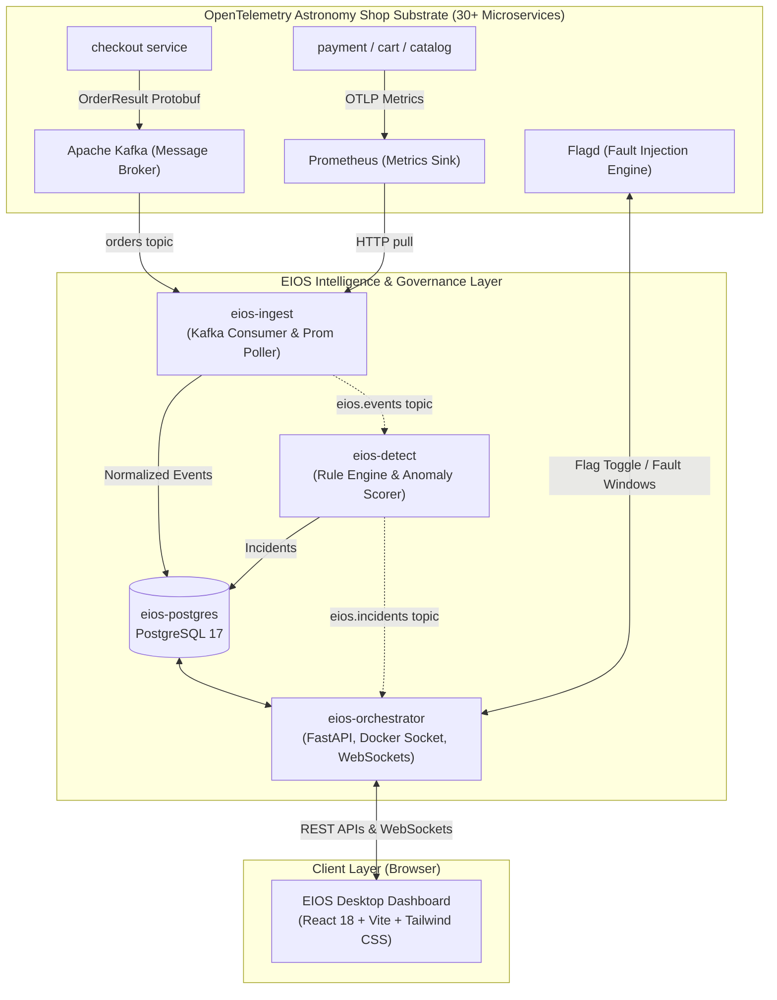

# EIOS: Enterprise Intelligence Operating System

> **A Cloud-Native Observability Intelligence & Incident Management Operating System**  
> Built on top of the OpenTelemetry Astronomy Shop Demo with real-time stream ingestion, automated anomaly detection, an interactive desktop operations environment, and cryptographically verified audit governance.

---

## 1. Executive Summary

**EIOS** (Enterprise Intelligence Operating System) is an autonomous intelligence layer designed to observe, correlate, detect, and remediate incidents across distributed cloud environments. 

Rather than replacing existing observability telemetry, EIOS deploys alongside upstream microservices—in this instance, the **OpenTelemetry Astronomy Shop Demo**—extracting events and metrics without modifying upstream application code. Incoming telemetry is continuously ingested, normalized into unified data contracts, evaluated against real-time statistical and domain-specific detection rules, and surfaced inside a **full-featured web desktop environment (EIOS Desktop)** equipped with terminal emulation, live service topology graphs, system process inspection, and security controls.



---

## 2. Core Architecture & Data Pipeline

EIOS separates data acquisition, state persistence, anomaly detection, orchestration, and user presentation into decoupled microservices:

### 2.1 Telemetry Ingestion (`eios-ingest`)
- **Domain B (E-commerce / Business Logic):** Subscribes to the Kafka `orders` topic as an independent consumer group (`eios-ingest`). It deserializes raw Protobuf `OrderResult` payloads produced by the checkout service without interfering with upstream accounting or fraud detection consumers.
- **Domain C (Infrastructure / Host Metrics):** Periodically queries Prometheus (`http://prometheus:9090`) to sample container CPU utilization, memory consumption, and network saturation across the fleet.
- **Normalization:** Translates disparate payloads into the canonical `NormalizedEvent` contract, storing numeric values in `metrics` (for detection rules) and situational metadata in `attributes` (for root-cause investigation).

### 2.2 Anomaly & Incident Detection (`eios-detect`)
- Consumes normalized events from `eios.events` or queries recent event windows from PostgreSQL.
- Evaluates statistical thresholds and domain-specific rules on sliding time windows (default: 30 seconds):
  - **`rule:order_rate_drop`**: Identifies catastrophic drops in order throughput against rolling historical baselines.
  - **`rule:payment_failure_spike`**: Detects elevated payment failure rates, triggering high-severity incidents.
  - **`rule:cart_error_spike`**: Surfaces cart degradation and transaction drop-offs.
  - **`rule:container_cpu_spike` & `rule:memory_leak`**: Flags runaway container resource exhaustion.
- Deduplicates and dampens notifications using configurable cooldown timers (default: 180 seconds) to prevent alert storms. Emits structured `Incident` records containing severity, anomaly score, and direct pointers to evidence event IDs.

### 2.3 Orchestrator & Backend Gateway (`eios-orchestrator`)
- **FastAPI Core:** Provides REST endpoints for stats, incident listings, service health, flag toggling, and container management.
- **WebSocket Streaming:** Pushes real-time incidents (`/ws/incidents`), service topology metrics, and interactive PTY terminal sessions (`/ws/terminal`) to the frontend.
- **Host & Container Management:** Mounts the Docker socket (`/var/run/docker.sock`) to inspect container statuses, restart failed services, or retrieve live logs.
- **Fault Injection Synchronization:** Interfaces directly with `Flagd` feature flags (`/etc/flagd/demo.flagd.json`) and synchronizes active fault toggles with the `fault_windows` database table for ground-truth benchmark evaluation.

### 2.4 EIOS Desktop Frontend (`eios-dashboard`)
- **Operating System Metaphor:** A desktop GUI built with React 18, Vite, and Tailwind CSS.
- **Window Management System:** Supports dragging, minimizing, maximizing, stacking, and taskbar management for multiple system tools:
  - **Service Topology Graph:** Live visual mapping of service dependencies and health states derived from Jaeger traces and Prometheus RED metrics.
  - **System Monitor:** Real-time container resource telemetry, status indicators, and one-click container actions.
  - **Integrated Terminal:** Web terminal emulator communicating with the host/orchestrator environment over WebSockets.
  - **Security Center:** Live auditing of access attempts, rate limits, PII redactions, and signature verifications.
  - **Application Onboarding & AI Assistant:** Interactive workflows for managing system configurations and guided troubleshooting.

---

## 3. Repository Directory Structure

```text
EIOS/
├── .vscode/                     # VS Code workspace settings & tasks
├── eios/                        # Core EIOS application & configuration layer
│   ├── dashboard/               # Frontend React 18 + Vite Web Desktop
│   │   ├── src/
│   │   │   ├── components/      # UI components & window managers
│   │   │   │   ├── os/          # Desktop windows (Terminal, Security, System Monitor, etc.)
│   │   │   │   ├── ui/          # Radix UI primitives & custom controls
│   │   │   │   └── ServiceGraph.tsx # Live service call graph
│   │   │   ├── hooks/           # Custom React hooks (WebSockets, system state)
│   │   │   ├── lib/             # Utility functions & API clients
│   │   │   ├── App.tsx          # Root application component
│   │   │   └── main.tsx         # React DOM entry point
│   │   ├── Dockerfile           # Multi-stage production container build
│   │   ├── package.json         # Dashboard dependencies and scripts
│   │   └── vite.config.ts       # Vite configuration with proxy settings
│   ├── db/                      # Database schema and initialization scripts
│   │   └── init.sql             # PostgreSQL DDL for events, incidents, fault_windows, cases
│   ├── detect/                  # Real-time incident detection engine
│   │   ├── Dockerfile           # Python 3.11 container definition
│   │   ├── main.py              # Event loop & detector runner
│   │   ├── rules.py             # Domain B and C detection rules
│   │   └── store.py             # Event querying & incident persistence
│   ├── ingest/                  # Telemetry ingestion taps
│   │   ├── Dockerfile           # Ingestion container definition
│   │   ├── main.py              # Ingestion loop for Kafka and Prometheus
│   │   ├── kafka_consumer.py    # OrderResult Protobuf consumer
│   │   └── prom_poller.py       # Prometheus OTLP metrics puller
│   ├── orchestrator/            # Central FastAPI control plane
│   │   ├── Dockerfile           # Orchestrator container definition
│   │   ├── main.py              # FastAPI application entry point
│   │   ├── agents_router.py     # AI agent endpoints & tool execution
│   │   ├── auth_router.py       # Authentication & session token management
│   │   ├── docker_router.py     # Docker container status & restart API
│   │   ├── fs_router.py         # File system browsing API
│   │   ├── security_router.py   # Security status & audit endpoints
│   │   ├── services_router.py   # Health, RED metrics, and trace endpoints
│   │   ├── system_router.py     # Host & memory diagnostics
│   │   ├── terminal_router.py   # WebSocket PTY terminal gateway
│   │   ├── flags.py             # Flagd feature flag toggle manager
│   │   ├── middleware.py        # Redaction & rate limiting middleware
│   │   └── topology.py          # Jaeger & Prometheus topology aggregator
│   ├── schemas/                 # Shared data contracts (Python Pydantic)
│   │   ├── events.py            # NormalizedEvent schema definition
│   │   └── incidents.py         # Incident and Case schema definitions
│   ├── scripts/                 # Operational & security utilities
│   │   ├── audit-verify.py      # HMAC-SHA256 audit log integrity validator
│   │   └── generate-secrets.ps1 # Secret generator for environment variables
│   ├── security/                # Security enforcement libraries & test suites
│   │   ├── audit.py             # Cryptographic append-only audit trail
│   │   ├── rate_limit.py        # Token-bucket sliding window rate limiter
│   │   ├── redaction.py         # PII masking (credit cards, tokens, emails)
│   │   └── tests/               # Security unit test suite
│   ├── compose.eios.yaml        # EIOS Compose layer definition
│   ├── compose.eios.security.yaml # Hardened security profile configuration
│   ├── start.ps1                # Automated Windows boot and recovery script
│   └── README.md                # EIOS layer documentation
├── opentelemetry-demo/          # Upstream Astronomy Shop substrate
│   ├── compose.yaml             # Base service definitions
│   ├── compose.full.yaml        # Full service mesh configuration
│   └── compose.observability.yaml # Prometheus, Jaeger, Grafana, OpenSearch
├── PROJECT.md                   # This project documentation
├── README.md                    # Root project documentation
└── start.ps1                    # Root wrapper startup script
```

---

## 4. System Prerequisites

| Requirement | Minimum | Recommended | Notes |
| :--- | :--- | :--- | :--- |
| **Operating System** | Windows 10/11 64-bit | Windows 11 with WSL 2 | Linux/macOS supported via Bash equivalents |
| **Memory (RAM)** | 8 GB free | 16 GB total | The full stack runs ~33 Docker containers |
| **Docker** | Docker Desktop 4.25+ | Latest Docker Desktop | Must have WSL 2 backend enabled |
| **Docker Compose** | Compose v2.20+ | Latest | Uses multi-file Compose composition (`-f`) |
| **Node.js / npm** | Node.js 18+ (Optional) | Node.js 20+ LTS | Only needed for local frontend development |
| **Python** | Python 3.11+ (Optional) | Python 3.11 or 3.12 | Only needed for running Python services outside Docker |

---

## 5. Terminal Run Commands

### 5.1 Automated Startup (Recommended)

From the project root in **PowerShell**:

```powershell
# 1. Start the entire stack (starts Docker Desktop automatically if not running)
.\eios\start.ps1

# 2. Or start with active demo traffic load (20 concurrent simulated users)
.\eios\start.ps1 -Demo
```

*What `start.ps1` handles automatically:*
1. Bootstraps Docker Desktop if the daemon is offline.
2. Runs the multi-file compose stack in detached mode (`-d`).
3. Handles Kafka healthcheck latency on cold boot and triggers a second pass if needed.
4. Auto-recovers the `checkout` service if its Kafka producer dropped during initialization.
5. Surfaces live status checks across all EIOS services.

---

### 5.2 Manual Docker Compose Startup

If running Docker Compose manually:

```powershell
cd C:\Users\Ishit\Desktop\EIOS\opentelemetry-demo

docker compose `
  -f compose.yaml `
  -f compose.full.yaml `
  -f compose.observability.yaml `
  -f ..\eios\compose.eios.yaml up -d
```

---

### 5.3 Running the Frontend Dashboard Locally (Vite Dev Server)

If you are modifying dashboard code or developing UI components, run Vite locally for instant Hot Module Replacement (HMR):

```powershell
# Navigate to the dashboard directory
cd C:\Users\Ishit\Desktop\EIOS\eios\dashboard

# Install npm dependencies (first time only)
npm install

# Start the Vite local development server
npm run dev
```

The dev server will run at:
- **Local URL:** `http://127.0.0.1:5173`
- *Note:* The local dashboard connects automatically to the orchestrator API at `http://127.0.0.1:8000`.

---

### 5.4 Running Python Services Locally (Without Docker)

To run a specific backend service directly on the host machine:

```powershell
# Orchestrator API
cd C:\Users\Ishit\Desktop\EIOS\eios\orchestrator
python -m pip install -r requirements.txt
python main.py

# Incident Detection Engine
cd C:\Users\Ishit\Desktop\EIOS\eios\detect
python -m pip install -r requirements.txt
python main.py
```

---

### 5.5 Stopping and Cleaning Up the Stack

To cleanly stop all running containers:

```powershell
cd C:\Users\Ishit\Desktop\EIOS\opentelemetry-demo

docker compose `
  -f compose.yaml `
  -f compose.full.yaml `
  -f compose.observability.yaml `
  -f ..\eios\compose.eios.yaml down
```

To stop containers **and wipe all persistent volumes** (PostgreSQL databases, Kafka logs, Grafana state):

```powershell
cd C:\Users\Ishit\Desktop\EIOS\opentelemetry-demo

docker compose `
  -f compose.yaml `
  -f compose.full.yaml `
  -f compose.observability.yaml `
  -f ..\eios\compose.eios.yaml down -v
```

---

## 6. Service Network Map & Port Allocations

> **Critical Notice for Windows:** Always navigate to services using `127.0.0.1` rather than `localhost`. On Windows, `localhost` resolves to IPv6 (`::1`) first and can result in 15-second connection hangs when Docker listens on IPv4 only.

| Service | Address | Description |
| :--- | :--- | :--- |
| **EIOS Dashboard** | [http://127.0.0.1:5173](http://127.0.0.1:5173) | Primary Web Desktop operations interface |
| **EIOS Orchestrator API** | [http://127.0.0.1:8000](http://127.0.0.1:8000) | REST API, OpenAPI docs (`/docs`), and WebSockets |
| **Astronomy Shop Storefront** | [http://127.0.0.1:8080](http://127.0.0.1:8080) | Upstream e-commerce website |
| **Flagd Feature Flags** | [http://127.0.0.1:8080/feature](http://127.0.0.1:8080/feature) | Web UI for fault injection toggles |
| **Jaeger Tracing UI** | [http://127.0.0.1:8080/jaeger/ui/](http://127.0.0.1:8080/jaeger/ui/) | Distributed trace search and dependency graphs |
| **Grafana Dashboards** | [http://127.0.0.1:8080/grafana/](http://127.0.0.1:8080/grafana/) | System metrics dashboards |
| **Locust Load Generator** | [http://127.0.0.1:8080/loadgen/](http://127.0.0.1:8080/loadgen/) | Traffic swarm controller |
| **Prometheus** | [http://127.0.0.1:9090](http://127.0.0.1:9090) | Raw metric queries and time-series inspector |
| **EIOS PostgreSQL** | `127.0.0.1:5433` | Database: `eios`, User: `eios`, Password: `eios` |
| **Astronomy PostgreSQL** | `127.0.0.1:63515` (dynamic) | Upstream application store |

---

## 7. Fault Injection & Incident Evaluation

EIOS includes an end-to-end evaluation harness to calculate precision, recall, and detection latency against ground truth.

### Injected Fault Types
Faults can be triggered via the Flagd UI at `http://127.0.0.1:8080/feature` or automated via the EIOS Orchestrator:

1. **`paymentFailure`**: Forces payment service to reject transactions, producing order drops in checkout.
2. **`cartFailure`**: Introduces errors in cart retrieval and item addition.
3. **`productCatalogFailure`**: Introduces latency or errors in catalog lookups.
4. **`emailMemoryLeak`**: Causes unbounded memory allocation in the email worker container.
5. **`adHighCpu`**: Triggers intensive computation loops inside the ad service.
6. **`kafkaQueueProblems`**: Introduces backpressure and queue delays in event processing.

### Evaluation Mechanism (`fault_windows`)
Whenever a flag is toggled through EIOS, an entry is written to the `fault_windows` database table:
- **True Positive (TP):** Any incident emitted during `[started_at, ended_at]` whose entity/domain matches the fault.
- **False Positive (FP):** Any incident fired outside of all active fault windows.
- **False Negative (FN):** An active fault window with zero detected incidents.

---

## 8. Security, Governance & Verification

EIOS implements enterprise security layers in `eios/security/`:

1. **Automated PII Redaction (`redaction.py`):**
   - Strips credit card numbers (Luhn check), bearer tokens, authorization headers, passwords, and emails before telemetry or audit logs are persisted.
2. **Token-Bucket Rate Limiter (`rate_limit.py`):**
   - Protects backend orchestrator endpoints from denial-of-service and brute force requests using rolling rate limits per IP / API key.
3. **Cryptographic Audit Trail (`audit.py`):**
   - Appends all critical actions (fault injection, container restarts, configuration updates) to an append-only log with HMAC-SHA256 signature chains.
4. **Audit Verification Script:**
   ```powershell
   cd C:\Users\Ishit\Desktop\EIOS\eios
   python scripts\audit-verify.py
   ```
5. **Running Unit Tests:**
   ```powershell
   cd C:\Users\Ishit\Desktop\EIOS\eios
   python -m pytest -q security\tests
   ```

---

## 9. Key REST & WebSocket Endpoints

| Method | Endpoint | Description |
| :--- | :--- | :--- |
| `GET` | `/api/stats` | Cluster summary (events ingested, open incidents, healthy services) |
| `GET` | `/api/incidents` | Filterable list of detected incidents with evidence metadata |
| `GET` | `/api/services` | Service statuses, RED error rates, and Jaeger trace links |
| `GET` | `/api/flags` | Live status of all Flagd fault injection flags |
| `POST` | `/api/flags/{name}` | Toggle a fault injection flag and record a fault window |
| `GET` | `/api/docker/containers` | Container list, health states, and resource usage |
| `POST` | `/api/docker/restart/{name}` | Restart a container by name |
| `GET` | `/api/security/status` | Security policy status, audit count, and active rate limits |
| `WS` | `/ws/incidents` | Real-time push notification stream for new incidents |
| `WS` | `/ws/terminal` | Full interactive PTY terminal session |

---

## 10. Diagnostics & Troubleshooting

### Q: The dashboard reports "Could not reach the orchestrator".
1. Check if `eios-orchestrator` is running:
   ```powershell
   docker ps --filter "name=eios-orchestrator"
   ```
2. Verify port 8000 is open:
   ```powershell
   Test-NetConnection -ComputerName 127.0.0.1 -Port 8000
   ```
3. Inspect orchestrator container logs:
   ```powershell
   docker logs eios-orchestrator --tail 100
   ```

### Q: Kafka reports "container unhealthy" on cold boot.
Kafka’s JVM can take up to 90 seconds to initialize on cold boot. Run `.\eios\start.ps1`, which explicitly waits for Kafka health and re-executes compose once the broker is ready.

### Q: Checkout service panics after Kafka restarts.
If checkout booted before Kafka was ready, its internal producer may have severed connection. Restart checkout:
```powershell
docker restart checkout
```

### Q: `npm install` fails with `ENOENT: no such file or directory`.
Make sure you are inside `C:\Users\Ishit\Desktop\EIOS\eios\dashboard` where `package.json` resides, rather than the root directory.
